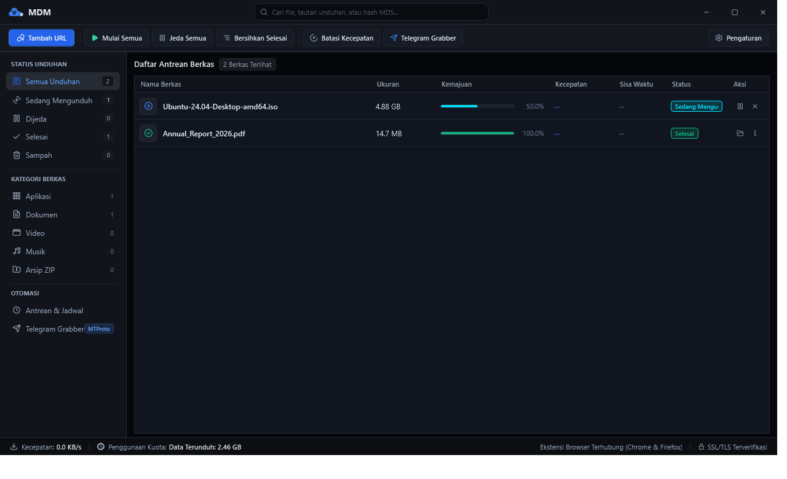

# MDM · Modern Download Manager

Unduh berkas besar, simpan audio YouTube sebagai MP3, dan pantau semuanya dari satu jendela di Windows. Saat koneksi dibutuhkan untuk rapat atau bermain gim, cukup batasi kecepatan unduhan dari toolbar.

## Dari tautan sampai berkas siap dibuka

- **Unduh berkas besar dalam beberapa bagian.** MDM memakai beberapa koneksi saat server mendukungnya. Pantau progres, kecepatan, dan perkiraan waktu selesai, lalu jeda atau lanjutkan transfer sesuai kebutuhan.
- **Ambil video atau audionya saja.** Lewat ekstensi browser, pilih kualitas video YouTube atau pilih **Audio Only** untuk menyimpan lagu, wawancara, atau materi belajar sebagai MP3.
- **Atur giliran unduhan.** Gunakan antrean dan jadwal untuk menentukan kapan transfer berjalan. Batas kecepatan membantu menyisakan bandwidth untuk aktivitas lain.
- **Temukan hasil unduhan.** Cari berdasarkan nama berkas atau tautan, lalu buka berkas atau foldernya lewat klik kanan. Gunakan **Bersihkan Selesai** untuk merapikan riwayat sambil tetap menyimpan berkas di disk.

## Mulai menggunakan MDM

1. Siapkan Windows x64 dengan **.NET 10 Desktop Runtime (x64)**, lalu jalankan installer **MDM_Setup.exe**.
2. Buka MDM, klik **Tambah URL**, dan tempel tautan berkas.
3. Pilih folder tujuan dan mulai unduhan. Progresnya langsung muncul di daftar antrean.

Untuk mengirim unduhan dari Chrome atau Edge, buka halaman ekstensi, aktifkan **Mode pengembang**, lalu pilih **Muat ekstensi yang belum dipaketkan** (*Load unpacked*). Pilih folder `extension` di dalam folder instalasi MDM. Biarkan MDM berjalan saat mengirim unduhan dari browser.
